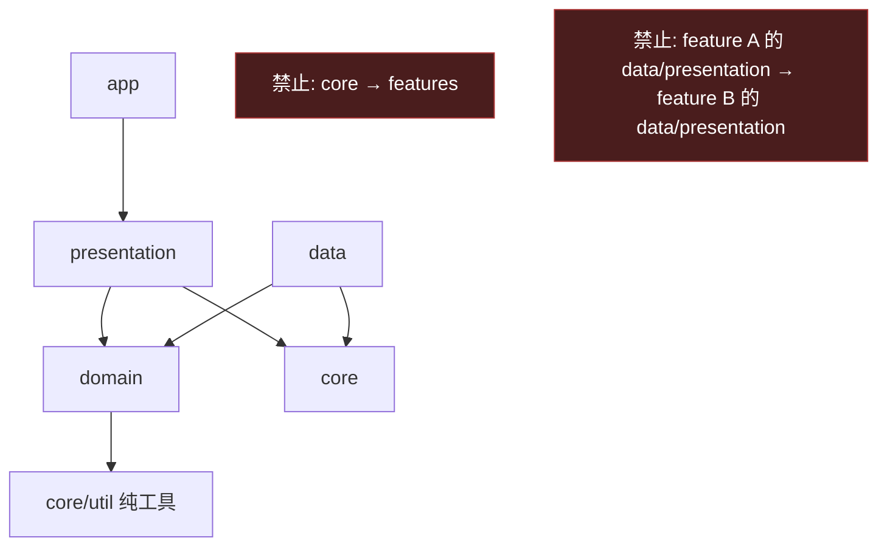
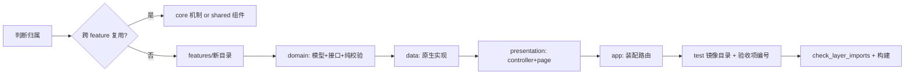

# 目录结构与分层规范

配套文档：[`PLAN.md`](./PLAN.md)（架构、里程碑、验收项 A1–A7）

| 项目 | 内容 |
|---|---|
| 文档版本 | v1.0（2026-10-17） |
| 适用范围 | 本仓库全部 Dart 与 Kotlin 代码 |
| 目标 | 结构可预测、依赖单向、业务逻辑可单测、新增功能不产生结构漂移 |

---

## 1. 设计原则

| 编号 | 原则 | 落地方式 |
|---|---|---|
| P1 | **单一事实源** | 通知、规则、历史的权威数据都在 Kotlin 侧；Dart 只持有镜像副本，不反向写业务状态 |
| P2 | **依赖单向** | `presentation → domain ← data`；`core` 被所有层依赖但绝不反向依赖 feature |
| P3 | **domain 可脱离框架测试** | Dart domain 不 import `package:flutter/*`；Kotlin domain 不 import `android.*`，从而可用纯 JVM 单测 |
| P4 | **通道集中** | 通道名与方法名只出现在 2 个文件（Dart 1 个、Kotlin 1 个）；业务代码禁止裸字符串 |
| P5 | **按职能分包，不按类型分包** | 用 `features/<功能>`，不建 `lib/models/`、`lib/screens/` 这类大杂烩目录 |
| P6 | **一个文件一个公共类型** | 文件名 = 类型的 snake_case；便于检索与 review |
| P7 | **契约版本化** | 跨语言 JSON 带 `schemaVersion`；不兼容变更要升级版本并双读兼容 |
| P8 | **测试目录镜像源码** | `lib/src/features/rules/...` ↔ `test/unit/features/rules/...` |
| P9 | **可控增长** | 新增能力先问"是 feature 还是 core 能力"，避免提前抽象 |
| P10 | **禁止抢占式抽象** | PoC 阶段不引入 DI 容器、代码生成、状态管理框架；用构造注入 + `ChangeNotifier` |

---

## 2. 顶层目录

```
notification_interceptor/
├─ PLAN.md                      # 计划与验收
├─ structure.md                 # 本文件：结构与分层规范
├─ README.md                    # 使用说明 + 能力边界（M5 完成）
├─ pubspec.yaml
├─ analysis_options.yaml        # 全库 lint 基线
├─ .gitignore
│
├─ assets/
│  └─ presets/
│     └─ generator_triage.json  # 生成器分流预设；UI 与 e2e 共用同一份文件
│
├─ docs/
│  ├─ decisions/                # 架构决策记录 ADR
│  │  ├─ 0001-native-rule-engine.md
│  │  ├─ 0002-testability-pipeline.md
│  │  ├─ 0003-e2e-probe-app.md
│  │  ├─ 0004-notification-generator.md
│  │  ├─ 0005-quantified-metrics.md
│  │  ├─ 0006-alert-sound-protocol.md
│  │  ├─ 0007-statistical-testing.md
│  │  └─ 0008-async-cancel-confirmation.md
│  └─ verification/             # 验收记录（A1–A7 的实测结果）
│     ├─ checklist.md
│     ├─ metrics.md             # tool/metrics.ps1 生成的量化报告
│     ├─ metrics.csv            # 逐条通知明细（可导入表格）
│     ├─ stats.md               # tool/stats.ps1 生成的显著性检验报告
│     └─ reports/               # tool/e2e.ps1 每次运行自动生成的 md + json
│
├─ tool/                         # 开发期脚本，不参与运行时
│  ├─ check_layer_imports.dart   # 分层依赖自动校验
│  ├─ notify_demo.ps1            # adb 造/查通知的辅助脚本
│  ├─ e2e.ps1                    # 端到端场景：装包→造通知→读历史→出报告（md + json）；-Bulk 大批量采样
│  ├─ metrics.ps1                # 从 e2e JSON 复算指标、写 metrics.md/csv、阈值回归
│  └─ stats.ps1                  # 从 e2e JSON 做显著性检验、写 stats.md（Wilson + 二项检验 + 时延 CI）
│
├─ android/                      # 见第 4 节（含 android/probe 测试探针模块）
├─ lib/                          # 见第 3 节
├─ test/                         # Dart 单测 + Widget 测
└─ build/  .dart_tool/  ...      # 生成物，git 忽略
```

规则：**顶层只放文档、配置与三端源码目录**。任何新类别（如 `assets/`）必须先在本节登记用途。

> `integration_test/` 已决定**不建立**：Dart 侧的 `integration_test` 只能驱动 Flutter
> 自身，无法合成"第三方 App 发通知"这类系统事件；端到端改用真实通知场景 +
> 探针 App（见 [ADR 0003](docs/decisions/0003-e2e-probe-app.md)）。

---

## 3. Dart / Flutter 侧结构

### 3.1 目录树

```
lib/
├─ main.dart                          # 唯一入口：仅做绑定初始化与注入通道
└─ src/
   ├─ app/
   │  ├─ app.dart                     # 仓储 → 控制器 → 界面 的装配点
   │  └─ theme.dart                   # 主题与语义色
   │
   ├─ core/                           # 跨 feature 的**机制**，不含业务规则
   │  ├─ channel/
   │  │  └─ interceptor_channel.dart  # 通道名/方法名/异常映射（P4）
   │  ├─ error/
   │  │  └─ interceptor_exception.dart
   │  ├─ util/
   │  │  ├─ json_cast.dart            # 平台 Map/List → 强类型，纯函数
   │  │  └─ time_format.dart
   │  └─ widgets/                     # 无业务语义的通用组件
   │     ├─ empty_state.dart
   │     └─ section_card.dart
   │
   ├─ shared/                         # 跨 feature 复用的领域类型与组件
   │  ├─ domain/
   │  │  ├─ rule_action.dart          # RuleAction / CancelStatus 枚举
   │  │  └─ decision.dart             # 引擎判定结果
   │  └─ widgets/
   │     ├─ app_scaffold.dart         # 底部导航 + FAB + 生命周期刷新
   │     └─ rule_action_chip.dart
   │
   └─ features/
      ├─ access/                      # 通知使用权：状态、引导、重连
      │  ├─ domain/
      │  │  ├─ access_status.dart
      │  │  └─ access_repository.dart
      │  ├─ data/
      │  │  └─ native_access_repository.dart
      │  └─ presentation/
      │     └─ access_controller.dart
      │
      ├─ feed/                        # 实时通知流
      │  ├─ domain/
      │  │  ├─ notification_record.dart
      │  │  ├─ notification_event.dart
      │  │  ├─ feed_item.dart
      │  │  └─ feed_repository.dart
      │  ├─ data/
      │  │  └─ native_feed_repository.dart
      │  └─ presentation/
      │     ├─ feed_controller.dart
      │     ├─ feed_page.dart
      │     └─ widgets/notification_card.dart
      │
      ├─ rules/                       # 规则编辑、静态校验、试运行
      │  ├─ domain/
      │  │  ├─ rule_set.dart          # RuleSet / RuleIssue / RuleSaveResult
      │  │  ├─ rule_spec.dart         # RuleSpec / MatchMode
      │  │  ├─ quiet_hours.dart       # 与原生 QuietHours 同语义
      │  │  ├─ rule_validation.dart   # 纯函数校验，可单测
      │  │  └─ rules_repository.dart
      │  ├─ data/
      │  │  └─ native_rules_repository.dart
      │  └─ presentation/
      │     ├─ rules_controller.dart
      │     ├─ rules_page.dart
      │     └─ rule_editor_page.dart
      │
      ├─ history/                     # 历史检索与导出
      │  ├─ domain/
      │  │  ├─ history_entry.dart
      │  │  ├─ history_query.dart     # 含 HistoryStats
      │  │  └─ history_repository.dart
      │  ├─ data/
      │  │  └─ native_history_repository.dart
      │  └─ presentation/
      │     ├─ history_controller.dart
      │     └─ history_page.dart
      │
      └─ settings/                    # 权限诊断、数据概览、能力边界
         └─ presentation/
            └─ settings_page.dart
```

> 与初版规划的差异（已落地）：`decision.dart` 与 `rule_action.dart` 上移到
> `shared/domain`（feed / history / rules 三处共用）；`notification_card.dart`
> 直接放在 `feed/presentation/widgets`；未创建 `router.dart`、
> `access_gate_page.dart`、`history_filter_bar.dart` 等未被使用的文件（P10 禁止抢占式抽象）。
> 新增文件前先在本节登记，否则视为结构漂移。

### 3.2 依赖规则（强制）



| 层 | 允许 import | 禁止 import |
|---|---|---|
| `presentation` | 同 feature 的 `domain`、`core`、`shared`、Flutter SDK | 同 feature 的 `data`；任何其他 feature 的 `data` / `presentation` |
| `domain` | `core/util`、`dart:*` | `flutter/*`、`core/channel`、`data` |
| `data` | 同 feature 的 `domain`、`core/channel`、`core/error` | `presentation`、其他 feature 的任意层 |
| `core` | `dart:*`、Flutter SDK | 任何 `features/*` |
| `app` | 各 feature 的 `presentation` 与构造函数、`core` | 直接 `data` 层 |

跨 feature 协作只允许两种方式：

1. **组合**：在 `app/app.dart` 或页面构造函数里注入，例如 rules 页需要包名列表 → 由 `FeedRepository` 的接口在 `app` 层注入。
2. **上移到 `core`**：当两个以上 feature 都需要同一机制且不含业务规则时。

### 3.3 分层职责

| 层 | 职责 | 不该做的事 |
|---|---|---|
| `domain` | 实体、值对象、校验纯函数、仓储接口、业务不变量 | 调通道、读文件、持有 `BuildContext` |
| `data` | 通道/文件 IO、JSON 序列化、异常翻译为 `InterceptorException` | 计算业务结论（如"该不该拦截"） |
| `presentation` | 控制器状态机（加载/空/错误/数据）、渲染、用户意图转成仓储调用 | 直接 `MethodChannel.invokeMethod` |
| `core` | 通用机制（编码、错误、工具、无业务组件） | 知道任何 feature 的概念 |
| `app` | 依赖装配、路由、主题 | 业务判定 |

### 3.4 状态管理约定

- 每个 feature **一个** 控制器，继承 `ChangeNotifier`，在页面 `State` 中创建并在 `dispose` 释放。
- 跨页面共享的实例在 `app` 层构造后经构造函数下传，**不使用全局单例**。
- 禁止把多个 feature 的状态塞进一个"AppState"（god object 反模式）。
- 控制器必须可注入仓储接口，以便测试时用 fake 替换。

---

## 4. Android / Kotlin 侧结构

### 4.1 目录树

```
android/
├─ settings.gradle.kts
├─ build.gradle.kts
├─ gradle.properties                  # 固定 org.gradle.java.home=D:\\Android_Studio\\jbr
└─ app/
   ├─ build.gradle.kts                # compileSdk 35 / targetSdk 35 / minSdk 26
   └─ src/
      ├─ main/
      │  ├─ AndroidManifest.xml
      │  ├─ res/values/strings.xml     # 用户可见文案集中
      │  └─ kotlin/dev/poc/notifinterceptor/
      │     ├─ MainActivity.kt          # 仅 FlutterActivity + 通道注册装配
      │     ├─ bridge/
      │     │  ├─ InterceptorBridge.kt  # MethodChannel 实现，方法名常量（P4）
      │     │  └─ EventDispatcher.kt    # EventChannel sink 管理 + 主线程投递
      │     ├─ listener/
      │     │  ├─ NotificationInterceptorService.kt
      │     │  └─ NotificationSnapshotFactory.kt
      │     ├─ domain/                  # 纯 Kotlin，禁止 android.*
      │     │  ├─ NotificationSnapshot.kt
      │     │  ├─ RuleSpec.kt           # RuleSpec + RuleSet
      │     │  ├─ QuietHours.kt
      │     │  ├─ RulePrimitives.kt     # RuleAction / MatchMode / CancelStatus
      │     │  ├─ Decision.kt           # Decision + RuleIssue
      │     │  ├─ RuleEngine.kt
      │     │  ├─ HistoryEntry.kt
      │     │  ├─ NotificationProcessor.kt   # 判定→取消→校验→落盘（副作用全部注入）
      │     │  └─ NotificationDeduplicator.kt # 同一 key 重复回调去重
      │     ├─ data/
      │     │  ├─ Json.kt               # org.json ↔ Map/List，隔离第三方类型
      │     │  ├─ JsonStore.kt          # 原子写、损坏回退
      │     │  ├─ RuleRepository.kt     # mtime 变化时丢弃缓存
      │     │  ├─ HistoryRepository.kt  # JSONL 环形保留，实现 HistorySink
      │     │  └─ AppInfoResolver.kt    # 包名 → 应用名（带缓存）
      │     └─ support/
      │        ├─ AppGraph.kt           # 进程级装配（Service 与 UI 共用实例）
      │        ├─ Cancellation.kt       # ServiceCanceller / DelayedCancelVerifier / SystemTimeSource
      │        └─ NotificationAccess.kt # 权限检测 + 跳转 + requestRebind
      └─ test/kotlin/dev/poc/notifinterceptor/domain/
         ├─ RuleEngineTest.kt            # 16 项匹配语义
         ├─ RuleJsonRoundTripTest.kt     # 落盘 JSON → 引擎的整链路
         ├─ NotificationProcessorTest.kt # 9 项：判定/取消/校验/落盘/异常吞掉
         ├─ NotificationDeduplicatorTest.kt # 7 项：重复、更新、容量淘汰
         ├─ RuleFixtureContractTest.kt   # 3 项：读 Dart 共享固件 test/fixtures/*.json
         ├─ RuleEngineStressTest.kt      # 4 项：500 轮随机化（顺序无关/幂等/无异常）
         └─ TestFixtures.kt              # 测试数据构造器
```

`android/probe/` 是独立的 Gradle 模块（`include(":probe")`），只在测试时安装：

```
android/probe/
├─ build.gradle.kts                   # namespace dev.poc.probe，无第三方依赖
└─ src/main/
   ├─ AndroidManifest.xml             # POST_NOTIFICATIONS + exported receiver
   └─ kotlin/dev/poc/probe/
      ├─ ProbeNotifications.kt        # 11 种通知形态 + verify/cancelAll
      └─ ProbeReceiver.kt             # POST / VERIFY / CLEAR 广播入口
```

`android/generator/`（`dev.poc.notifgen`）是给人和脚本用的**通知生成器**：

```
android/generator/
├─ build.gradle.kts                   # namespace dev.poc.notifgen
└─ src/main/
   ├─ AndroidManifest.xml             # LAUNCHER Activity + exported receiver
   ├─ res/values/strings.xml          # 所有固定 UI 文案
   └─ kotlin/dev/poc/notifgen/
      ├─ NoticeCorpus.kt              # 13 类自然语言语料 + 加权随机 + 值填充
      ├─ Generator.kt                 # 渠道、样式、tag 约定、verify/clear
      ├─ GenReceiver.kt               # POST / VERIFY / CLEAR 广播入口
      └─ GeneratorActivity.kt         # 随机一条 / 连发 / 自动 / 清空
```

为什么必须是独立包而不是主应用里的一个按钮：`NotificationInterceptorService`
会放行自身包名的通知（防止自触发循环），同包就永远演示不出"过滤第三方通知"。
探针与生成器的区别：探针造**系统形态**（ongoing/进度/分组）用于测试；
生成器造**真实文案**（营销/验证码/群聊）用于演示与压力场景。

为什么不用 `integration_test/`：Dart 侧的端到端只能驱动 Flutter 自身，
无法合成"第三方 App 发布通知"这一系统事件；探针 App 用真实
`NotificationManager` 造通知，才是被测对象的真实输入。

### 4.2 原生侧分层规则

| 包 | 职责 | 约束 |
|---|---|---|
| `listener` | 系统回调 → 快照 → 交给执行器 | 回调内不做 IO/正则；不直接持有 Bridge |
| `domain` | 匹配与判定、模型 | **禁止 `import android.*`**，保证纯 JVM 单测 |
| `data` | 文件读写、包名解析 | 不实现匹配；不感知 UI |
| `bridge` | Dart ↔ Kotlin 边界 | 只做参数校验、调用编排、异常转 `errorCode` |
| `support` | 平台能力封装 | 不含业务规则 |

`NotificationInterceptorService`、`MainActivity` 与 `Bridge` 之间的连接通过 `support` 中的单例持有者（`ServiceLocator` 级别的简单对象）完成，**不在 Service 里 new 仓储**，以便测试与解耦。

### 4.3 线程与生命周期契约

- `onNotificationPosted` / `onNotificationRemoved`：主线程，只提取快照并 `executor.execute {}`。
- 判定与取消：单线程执行器；取消后可选延迟校验（见 PLAN 风险表）。
- `EventDispatcher.post()`：内部切主线程，任一时刻只有一个 sink。
- 服务 `onDestroy` 时注销 dispatcher；不 `stopSelf()`，交由系统管理。
- 历史/规则的写操作全部在 IO 执行器，`@Volatile` + `synchronized` 保护内存副本。

---

## 5. 关键文件职责

| 文件 | 唯一职责 | 变更影响面 |
|---|---|---|
| `lib/src/core/channel/interceptor_channel.dart` | 通道名/方法名、异常翻译 | 高：改这里等于改契约 |
| `lib/src/core/util/json_cast.dart` | 平台 Map/List → 强类型，纯函数 | 低 |
| `lib/src/features/*/data/native_*_repository.dart` | 把通道调用翻译为领域对象 | 中 |
| `lib/src/features/rules/domain/rule_validation.dart` | 纯校验：正则合法性、时段格式、条件非空 | 低，纯函数 |
| `RuleEngine.kt` | 首条命中判定（PLAN §3.4 语义） | 高：安全与行为核心，必须有单测 |
| `NotificationSnapshotFactory.kt` | extras → 快照，处理 null 与类型异常 | 中 |
| `HistoryRepository.kt` | 追加、轮转、查询、导出 | 中 |
| `InterceptorBridge.kt` | 契约实现与方法注册 | 高 |
| `MainActivity.kt` | 仅装配 | 低 |

---

## 6. 命名与代码约定

| 类别 | 规则 | 示例 |
|---|---|---|
| Dart 文件 | `snake_case.dart` | `rule_editor_page.dart` |
| Kotlin 文件 | `PascalCase.kt`，一个公共类型 | `RuleEngine.kt` |
| 页面组件 | 以 `Page` 结尾 | `RulesPage` |
| 可复用组件 | 以语义命名，不带 `My` | `EmptyState` |
| 控制器 | `<Feature>Controller` | `RulesController` |
| 仓储接口 / 实现 | `<X>Repository` / `Native<X>Repository` | `RulesRepository` → `NativeRulesRepository` |
| 通道方法 | 动词开头 camelCase | `getHistory`、`saveRules` |
| 事件类型 | 名词过去式 | `posted`、`removed`、`statusChanged` |
| JSON 字段 | camelCase（两端一致） | `packageName`、`isOngoing` |
| 错误码 | `SCREAMING_SNAKE_CASE` | `PERMISSION_DENIED`、`SERVICE_NOT_CONNECTED` |
| Kotlin 常量 | `companion object` 内 `UPPER_SNAKE` | `CHANNEL_NAME` |
| 测试 | `<被测类型>Test`；验收用例带 A 编号 | `RuleEngineTest.a4_invalidRegexSkipsRule` |

其他：

- Dart 开启 `strict-casts`、`strict-inference`、`strict-raw-types`；公共 API 必须标注类型。
- Kotlin 使用 `-Werror` 之外保持默认，但对 `domain` 包启用显式返回类型检查（ktlint/编译选项按需）。
- 注释只解释"为什么"，不解释"是什么"；`TODO` 必须带负责人或 issue 编号。
- 用户可见文案进 `res/values/strings.xml`（原生）或集中常量（Flutter），不散落硬编码。

---

## 7. 跨语言契约

1. **版本号**：规则包 `schemaVersion`，历史记录 `schemaVersion`；Dart 模型解析时校验，未知高版本降级只读。
2. **字段兼容**：新增字段可选（`?`），删除字段须两个版本后再删。
3. **类型严格**：Dart 侧解析必须容忍 `null`、`int`/`double` 混用（`priority` 等），失败时整条丢弃并记录日志，不让一条坏数据崩列表。
4. **契约测试**：`test/unit/features/rules/rule_validation_test.dart` 使用固定 JSON 固件
   （`test/fixtures/*.json`）；Kotlin 侧 `RuleJsonRoundTripTest` 用同一份字段结构做整链路验证。
5. **枚举**：两端都用字符串（`intercept` / `allow` / `log_only`），不使用序号，避免增删导致错位。

---

## 8. 测试架构

### 8.1 五层模型

| 层 | 手段 | 覆盖 | 命令 | 反馈时间 |
|---|---|---|---|---|
| L1 纯 JVM 单测 | JUnit，无 Android 依赖 | 规则语义、处理流水线、去重、契约固件、随机化 | `gradlew :app:testDebugUnitTest` | 秒级 |
| L2 Dart 测试 | `flutter test` | 控制器、模型解析、页面渲染 | `flutter test` | 秒级 |
| L3 结构检查 | `tool/check_layer_imports.dart` | 分层依赖是否被破坏 | `dart run tool/check_layer_imports.dart` | 秒级 |
| L4 端到端场景 | 探针 App + 生成器 + `tool/e2e.ps1` | 真实通知形态、跨进程取消、落库、热加载、重启 | `tool\e2e.ps1` | 数分钟 |
| L4+ 量化 | `tool/metrics.ps1`（读 e2e JSON） | 准确率、时延分位、取消成功率、重复率、响铃观测、阈值回归 | `tool\metrics.ps1 -Gate` | 秒级 |
| L4+ 统计 | `tool/stats.ps1`（读 e2e JSON） | 漏拦/误拦率的 Wilson 区间与单侧二项检验、分档时延均值 CI | `tool\stats.ps1 -Gate` | 秒级 |
| L5 真机 / OEM | 手工清单 | 厂商 ROM 的取消策略、保活、权限差异 | `docs/verification/checklist.md` | 人工 |

分层原则：**能用 L1 断言的行为不要下推到 L4**。L4 只做 L1–L3 无法证明的事：
真实的系统回调时序、跨进程取消是否被系统接受、设备重启后的状态恢复。

### 8.2 让原生代码可测：副作用注入

`listener` 层只保留 Android 耦合（生命周期、快照提取、线程投递），
**判定→取消→校验→落盘**整条流水线抽到 `domain/NotificationProcessor`，
通过 5 个函数式接口注入副作用，从而能在 JVM 上完整测试：

```
RuleEvaluator      (snapshot) -> Decision        规则引擎
NotificationCanceller (key) -> Boolean           真实取消
CancelVerifier     (key) -> CancelStatus          取消后校验
HistorySink        (entry) -> Unit                历史落库
TimeSource / IdFactory                            时间与 ID
```

这就是"模拟真实情况"的第一层：把**不依赖设备的行为**从设备里拔出来。

### 8.3 模拟真实情况的四种手段

| 手段 | 解决什么问题 | 实现 |
|---|---|---|
| 真实通知形态 | `cmd notification post` 只能造 basic 通知 | 探针 App 用 `NotificationManager` 造 ongoing/no-clear/静默渠道/分组/MessagingStyle/进度/批量 |
| 真实时序 | 重复回调、分组重排、批量排队 | `NotificationDeduplicator` 单测 + `burst-10` 场景断言 `duplicates=0` |
| 真实系统判定 | 有些通知系统根本不允许取消 | `CancelStatus` 三态落库，`observe-ongoing/progress` 只观测不断言 |
| 真实状态迁移 | 界面销毁、规则热改、授权撤销、重启 | `ui-closed` / `rules-hot-reload` / `permission-revoked` / `reboot-persistence` |
| 真实文案 | 规则在自然语言上是否可靠 | `dev.poc.notifgen` 生成器 + `generator-triage` 场景（24 条随机通知，断言"只留白名单"） |

### 8.4 端到端脚本必须遵守的三条

1. **先证明环境就绪，再断言功能**（`Invoke-WarmUp`）：服务是否可用只能用功能判据
   ——真的收到一条通知并入库。查 `dumpsys` 或 settings 都会被"绑定记录残留"骗到。
2. **时间窗用设备时钟**（`Get-DeviceMillis`）：主机与设备时钟可能不一致，
   历史条目的 `postTime` 是设备时间。
3. **区分 FAIL 与 OBSERVED**：OBSERVED 是"记录系统行为"（如 ongoing 不可取消），
   不计入失败；只有产品承诺的行为才允许 FAIL。

### 8.5 量化指标管线

端到端只回答"过/不过"，不足以判断质量与回归。因此把每次运行变成可复算的数据：

```
tool/e2e.ps1            ──►  reports/e2e-<stamp>.json   （逐条通知 + 每场景事件统计）
tool/e2e.ps1 -Bulk N    ──►  reports/e2e-<stamp>.json   （大批量采样，只收数据不断言）
                                 │
                                 ├──► tool/metrics.ps1 ──► verification/metrics.md
                                 │                         verification/metrics.csv
                                 │                         -Gate：超阈值 exit 1
                                 │
                                 └──► tool/stats.ps1   ──► verification/stats.md
                                                          显著性检验（漏拦/误拦/时延 CI）
```

JSON 里每条通知含：`key/tag/package/channelId/expected/action/cancelStatus/ruleId/
postTime/decisionTime/latencyMs`；每个场景含 `enqueued/alerted/coalesced/
suppressedOther/belowThreshold/cancelledByIc`（来自 `logcat -b events` 的
`notification_enqueue`、`notification_alert`、`notification_canceled`）；
响铃专项另有 `alerts[]`，逐条用例记录同样的字段（协议见
[ADR 0006](docs/decisions/0006-alert-sound-protocol.md)）。

**采样与断言分离**：`-Bulk` 只发通知、只收集记录，不做断言；它存在的唯一理由是
把样本量从"几十条"抬到"几百条"，因为统计结论的强度完全由样本量决定
（0 错误时可宣称的上界 ≈ 3/n）。检验逻辑集中在 `tool/stats.ps1`，口径见
[ADR 0007](docs/decisions/0007-statistical-testing.md)。

三条度量纪律：

1. **期望值必须来自数据，不来自被测代码**：生成器的 `keep` 标记、场景定义的
   `ExpectAction` 才是 ground truth，否则 precision/recall 是自己证明自己。
2. **OBSERVED 场景不进分母**：ongoing/progress 被系统拒绝是事实记录，不是缺陷。
3. **响铃要看 EventLog，不看"通知还在不在"**：`aboveThreshold=1` 才代表真的响；
   且必须**先清空托盘 + 静默 8 秒**再发，否则会撞上系统对同应用的打扰抑制，
   测到的是 OS 策略而不是我们的行为。

第四条（统计纪律）：**0 个错误不等于不会出错**。报告里必须同时给出点估计、
Wilson 95% 区间、以及"当前样本量能证到的最严格上界"三项；时延必须按
"单条 / 并发批"分档，不能混算。

第五条（时延纪律）：**时延必须拆到"谁引入的"**。外部等待（系统分发）与自己引入的
等待（固定 sleep、同步写盘）要分开报，否则会把自己的实现选择当成平台限制。
取消确认与落盘已改为异步（[ADR 0008](docs/decisions/0008-async-cancel-confirmation.md)），
单条拦截时延从 466.7 ms 降到 208.6 ms。

### 8.6 测试目录映射

```
test/                                # Dart：与被测目录镜像
├─ fixtures/                         # 与 Kotlin 测试共用的 JSON 固件
│  ├─ rule_set_v1.json
│  └─ history_entry_v1.json
├─ unit/
│  ├─ core/util/
│  │  ├─ json_cast_test.dart
│  │  └─ time_format_test.dart
│  └─ features/
│     ├─ access/access_controller_test.dart
│     ├─ feed/feed_controller_test.dart
│     ├─ feed/notification_record_test.dart
│     ├─ rules/rule_validation_test.dart
│     ├─ rules/rules_controller_test.dart
│     ├─ rules/generator_preset_test.dart
│     └─ history/history_controller_test.dart
└─ widget/
   ├─ rules_page_test.dart           # 空态 / 列表 / 非法正则 / 无条件提示
   ├─ settings_preset_import_test.dart # 一键导入分流预设
   └─ app_scaffold_test.dart         # 四个 tab 渲染 + 未授权引导

android/app/src/test/kotlin/…/domain/ # Kotlin：纯 JVM，无 android.*
android/generator/src/test/kotlin/…/  # 语料可复现 + tag 契约
android/probe/                        # 测试探针 App（系统形态，不入主包）
android/generator/                    # 通知生成器 App（真实语料，演示用）
assets/presets/                       # 与 UI、e2e 共用的规则预设
docs/verification/reports/            # e2e 报告（自动生成，按时间戳命名）
```

约束：

- Widget 测试**不得**触达真实通道；必须注入 fake repository。
- Kotlin `domain` 测试不得使用 Robolectric（纯 JVM 即可），触碰 `android.*` 的代码一律放 `support`/`data` 并在集成阶段验证。
- 每个验收项至少一条自动化用例；A6（ROM 差异）允许只做手工记录，写入 `docs/verification/checklist.md`。

---

## 9. 结构自动校验

`tool/check_layer_imports.dart`（M0 一并建立，纳入 `flutter test` 前的检查步骤）规则：

1. `lib/src/core/**` 不得出现 `import '../features/` 或 `package:.../src/features/`。
2. `lib/src/features/*/domain/**` 不得 import `package:flutter/`、`core/channel`、本 feature 的 `data/`。
3. `lib/src/features/*/presentation/**` 不得 import 本 feature 的 `data/`，也不得 import 其他 feature 的 `data|presentation`。
4. 仅 `**/data/native_*_repository.dart` 与 `core/channel/**` 可以出现 `MethodChannel(` / `EventChannel(`。
5. `android/.../domain/**` 不得出现 `import android.`。

违反时脚本以非 0 退出并打印 `文件:行号 规则编号`，CI/本地命令统一为：

```powershell
dart run tool/check_layer_imports.dart
```

---

## 10. 新增功能工作流



提交前自检：

- [ ] 新增文件落在正确的层，且没有反向 import。
- [ ] 通道改动同步更新两端常量与 `schemaVersion`。
- [ ] 新增业务规则有 domain 纯函数单测。
- [ ] 控制器可注入 fake，页面无直接通道调用。
- [ ] 文档（PLAN 验收项 / `docs/verification`）已更新。
- [ ] `dart run tool/check_layer_imports.dart` 与 `flutter analyze` 通过。

---

## 11. 明确禁止

1. 在 `main.dart` 写业务逻辑或注册通道（通道在 `MainActivity` / `app` 装配层完成）。
2. Widget 中出现 `MethodChannel`、`invokeMethod`、裸通道字符串。
3. 在 Dart 重写通知匹配逻辑（必须调用原生 `evaluateSample`）。
4. 全局可变单例承载业务状态。
5. `lib/models/`、`lib/utils/`、`lib/screens/` 这类按技术类型平铺的目录。
6. 为"将来可能用到"提前建空目录或空抽象。
7. 直接把原始 `PlatformException` 抛给 UI。
8. 在监听回调主线程做文件 IO 或正则编译。

---

## 12. 演进路径

| 触发条件 | 调整 |
|---|---|
| 规则数量 > 200 或需复杂查询 | `RuleRepository` 换 SQLite（`data` 层替换，`domain` 接口不变） |
| 需要多页面共享复杂状态 | 引入 Riverpod，仅改 `presentation` 装配方式 |
| 出现第三个复用组件 | 将 `features/x/presentation/widgets` 上移到 `shared/widgets` |
| 需要保活/前台服务 | 新增 `android/.../service/` 包，`listener` 保持只做回调转发 |
| 规则需要脚本化（用户自定义表达式） | 在 `domain` 增 `ExpressionEvaluator` 接口，实现放 `data`，先做白名单 DSL 而非任意脚本 |

任何一项落地前，先在 `docs/decisions/` 写 ADR。

---

## 13. 变更记录

| 日期 | 版本 | 变更 |
|---|---|---|
| 2026-10-17 | v1.0 | 初版：分层规则、目录树、命名约定、依赖校验与演进路径 |
| 2026-10-17 | v1.1 | 按实际实现回写 Dart/Kotlin 目录树与测试映射；`json_cast.dart` 迁至 `core/util`；标注未创建的计划文件 |
| 2026-10-17 | v1.2 | 第 8 节改为「测试架构」五层模型 + 副作用注入 + 模拟真实情况的手段；登记 `android/probe/`、`tool/e2e.ps1`、`docs/verification/reports/`；明确不建 `integration_test/`（ADR 0003） |
| 2026-10-17 | v1.3 | 登记 `android/generator/`（通知生成器）与 `assets/presets/`；说明生成器为何必须独立成包（自触发放行）；测试架构新增「真实文案」手段 |
| 2026-10-17 | v1.4 | 新增 8.5「量化指标管线」：e2e → JSON → metrics.ps1 → metrics.md/csv + 阈值回归；登记 `tool/metrics.ps1`、`docs/verification/metrics.*`；补充三条度量纪律（ground truth 来源、OBSERVED 不进分母、响铃看 EventLog） |
| 2026-10-17 | v1.5 | 量化管线扩展响铃专项：JSON 新增 `alerts[]` 与 `suppressedOther`；登记 ADR 0006 受控协议（清空托盘 + 静默 8 s + 对照组）；生成器新增响铃模式 |
| 2026-10-17 | v1.6 | 新增显著性检验层：`tool/e2e.ps1 -Bulk`（采样与断言分离）、`tool/stats.ps1`、`docs/verification/stats.md`、ADR 0007；8.5 增补第四条度量纪律（0 错误只给上界、时延必须分档） |
| 2026-10-18 | v1.7 | 取消确认改回调驱动：新增 `support/RemovalDrivenCancelTracker`、`support/AsyncHistorySink`、`support/ImmediateCancelVerifier`，`CancelStatus` 增加 `PENDING` 中间态；登记 ADR 0008 与第五条时延纪律；单条拦截 466.7→208.6 ms、批量 p95 9663→435 ms |
